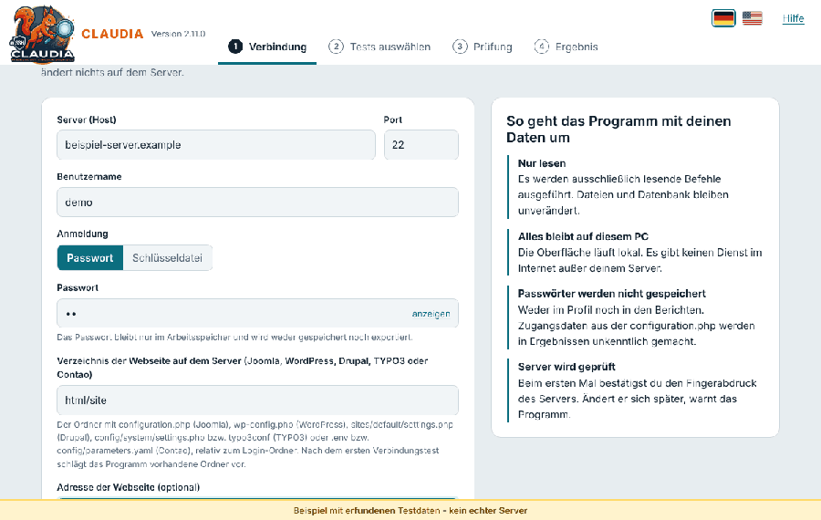
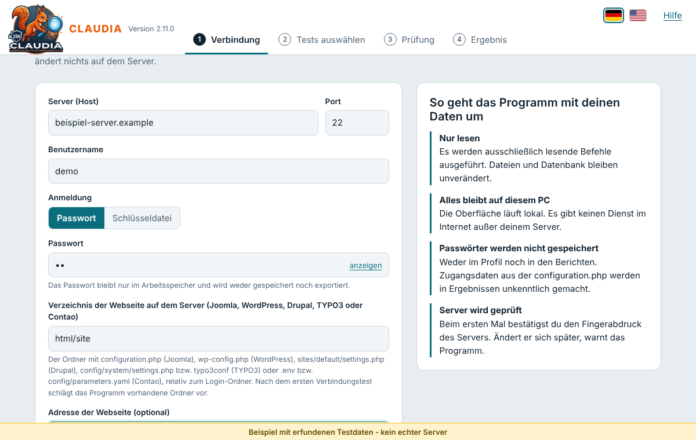
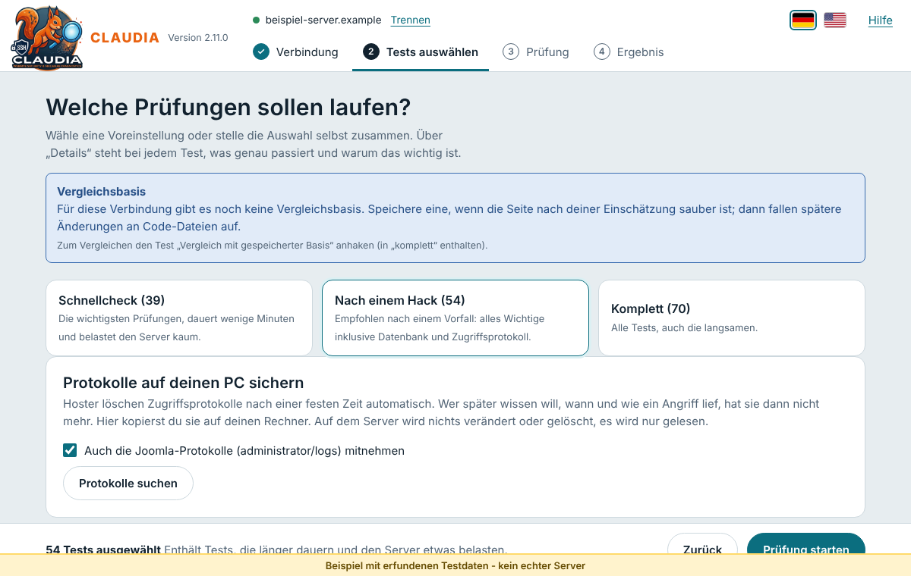
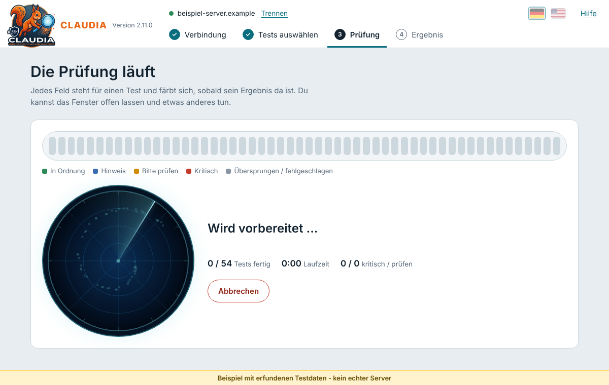
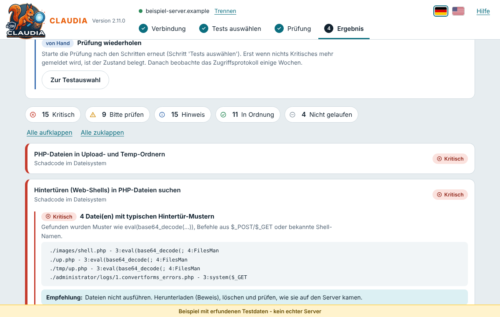

# CLAUDIA

CLAUDIA ist ein kostenloses Windows-Programm (Python, Standardbibliothek + paramiko), das eine **Joomla**-, **WordPress**- (auch mit WooCommerce-Shop), **Drupal**- (ab Version 8), **TYPO3**- (ab Version 11) oder **Contao**-Seite (ab Version 4.13) über eine verschlüsselte SSH-Verbindung auf Spuren eines Hacks und auf typische Schwachstellen prüft.
Die Oberfläche läuft lokal auf `127.0.0.1` im Browser, auf Deutsch und Englisch (Flaggen), mit eingebauter Dokumentation.

## Grundsätze

- **Alle Prüfungen sind nur lesend.** Eine Prüfung ändert, löscht oder installiert nichts auf dem Server.
- **Änderungen nur über "Lösungen auf Knopfdruck"**: feste Aktionen mit Befehlsvorschau, ausdrücklicher Bestätigung und vorheriger, geprüfter Sicherung.
- **Nur verschlüsselte Verbindungen** (SSH/SFTP, https für Online-Abfragen).
- **Keine Geheimnisse gespeichert oder exportiert.** Passwörter und API-Schlüssel bleiben im Arbeitsspeicher.
- **Ehrliche Grenzen.** CLAUDIA sucht bekannte Spuren. "Keine Auffälligkeiten" beweist nicht, dass eine Seite sauber ist.

## So sieht es aus

Alle Bilder zeigen ein **Beispiel mit erfundenen Testdaten** (nachgebauter Server, keine echte Seite).

| Verbinden | Prüfungen wählen |
|---|---|
|  |  |
| **Prüfung läuft** | **Befunde, kritische zuerst** |
|  |  |

Jeder Befund nennt, was gefunden wurde, die betroffenen Dateien oder Einträge und eine Empfehlung. Kritische Befunde sind rot markiert und stehen oben.

## Herunterladen und starten (ohne PowerShell)

Du brauchst weder PowerShell noch die Eingabeaufforderung:

1. Auf der Seite **Releases** dieses Repositorys (rechts auf der Startseite) die neueste Version öffnen und die Datei `Claudia_v….zip` herunterladen. Dort steht auch die SHA-256-Prüfsumme; sie lässt sich mit `PRUEFSUMMEN.txt` vergleichen.
2. ZIP in einen normalen Ordner entpacken.
3. **Windows:** `start.bat` doppelklicken. **Mac:** `start.command` doppelklicken. Mehr ist nicht nötig; fehlt Python, richtet die Startdatei es selbst ein.

Eine einzelne `.exe` bzw. Mac-App gibt es bewusst noch nicht: Ohne Code-Signatur würden Windows und macOS stärker warnen als bei der Startdatei. Sie kommt zusammen mit dem Installer (siehe "Geplant"), erst dann lohnt sich eine Signatur.

## Schnellstart (Windows)

1. ZIP in einen normalen Ordner entpacken.
2. `start.bat` doppelklicken (einzige Startdatei, richtet sich beim ersten Start selbst ein). Fehlt Python, lädt und installiert start.bat es automatisch (python.org, Signatur geprüft, nur für dein Benutzerkonto, kein Neustart nötig). Beim ersten Start entsteht die Verknüpfung `CLAUDIA.lnk` mit dem Eichhörnchen-Symbol.
3. SSH-Zugangsdaten des Hosters eintragen, Prüfungen wählen, starten.

Entwicklung, Tests und Dokumentation: siehe [README.md](README.md) und das Handbuch im Programm (Knopf "Hilfe") bzw. `Claudia_Dokumentation.html`.

## Schnellstart (Mac, ab 2.9.0, noch nicht auf einem echten Mac getestet)

1. ZIP im Finder entpacken. 2. `start.command` doppelklicken (beim ersten Mal Rechtsklick > Öffnen). Fehlt Python 3.9+, lädt start.command den offiziellen Installer von python.org, prüft die Signatur und installiert ihn (macOS fragt nach deinem Passwort). 3. SSH-Zugangsdaten eingeben und starten.

## Warnung von Windows oder Virenscanner (zu erwarten)

Windows (SmartScreen, Defender) oder ein anderer Virenscanner kann vor CLAUDIA oder `start.bat` warnen oder sie als Schadsoftware bzw. mögliches Einfallstor einstufen. **Das ist nachvollziehbar und in einem Punkt richtig:** CLAUDIA kann SSH-Verbindungen zu einem Server aufbauen, genau so arbeitet das Programm. Es tut das **nur, wenn du es willst**: Du gibst die Zugangsdaten selbst ein, startest selbst eine Prüfung, und die Verbindung geht nur zu dem Server, den du eingetragen hast. Es gibt keine Verbindung im Hintergrund, und nichts startet von selbst.

Weitere Gründe für Warnungen: Das Programm ist nicht code-signiert (unbekannter Herausgeber), und `start.bat` kann Python herunterladen und installieren, wenn es fehlt.

Das kannst du tun:
- Nur aus diesem Repository herunterladen und die Dateien mit `PRUEFSUMMEN.txt` vergleichen.
- Der Quelltext ist offen; vor dem Start selbst lesen oder prüfen lassen.
- Wenn du dich entscheidest, zu vertrauen: in SmartScreen "Weitere Informationen" und dann "Trotzdem ausführen" wählen, oder im Virenscanner nur den CLAUDIA-Ordner erlauben. Den Schutz nicht allgemein ausschalten.

## Geplant

Die Reihenfolge ist Absicht: erst alle Systeme, dann Härtung, dann Komfort. Zugesagt ist nur, was schon unter "Änderungen" im Handbuch steht; alles hier ist Planung und kann sich ändern.

1. **Weitere Systeme, je ein Release:** PrestaShop, danach Shopware (Joomla, WordPress mit WooCommerce, Drupal, TYPO3 und Contao sind da). Jedes bekommt die gleichen lesenden Prüfungen: Kern und Originaldateien, Einstellungen, abrufbare Dateien, Erweiterungen mit Sicherheitsmeldungen, Konten und Code in Inhalten. Lösungen auf Knopfdruck für diese Systeme gibt es nur nach ausdrücklicher Freigabe.
2. **Code-Prüfung und Härtung:** Der gesamte Code wird auf Schwachstellen und Doppelungen durchgesehen; Missbrauch soll so schwer wie möglich werden.
3. **Englische Übersetzung vervollständigen** (danach, damit sich die Texte nicht mehr ändern).
4. **Update-Prozess:** CLAUDIA meldet neue Versionen und prüft vor dem Austausch die Prüfsumme (mit Sicherung und Weg zurück).
5. **Dashboard:** Übersicht über mehrere Seiten und den Verlauf der Befunde.
6. **Lizenzschlüssel:** ein Schlüssel, der Funktionen freischaltet (das Konzept wird vorher abgestimmt).
7. **Installer** für Windows und Mac (mit Code-Signatur, danach auch eine einzelne `.exe` bzw. Mac-App).
8. **Praxistests** auf echten Windows- und Mac-Rechnern mit echten Seiten.

Wünsche und Fehler bitte als Issue melden (Vorschläge zum Code als Pull Request, siehe CONTRIBUTING.md).

## Lizenz & Nutzung

CLAUDIA wird öffentlich bereitgestellt, um sie zu testen und weiterzuentwickeln. Die genauen Bedingungen regelt die [LICENSE](LICENSE); die deutsche Fassung ist verbindlich.

- **Kostenlos nutzbar:** Privatpersonen (nicht kommerziell) sowie gemeinnützige Organisationen und Vereine (für gemeinnützige Zwecke), jeweils auf eigenen Seiten.
- **Keine kommerzielle Nutzung ohne Freigabe:** Unternehmen, Selbständige, Agenturen und Behörden müssen vorab über mein GitHub-Profil ([@conejito-vipe](https://github.com/conejito-vipe)) eine Freigabe bzw. Lizenz anfragen. Das gilt auch für die Prüfung von Kundenseiten.
- **Keine Änderung, keine Weitergabe:** Die Software darf nicht verändert und nicht an Dritte weitergegeben werden, auch nicht unverändert. Der Quelltext ist zum Lesen und Prüfen da.
- **Ausschlüsse:** Politische Parteien sowie Vereine oder Gruppen, die vom Verfassungsschutz (Bund oder Land) als rechtsextremistische Bestrebung eingestuft oder verboten sind, sind von der Nutzung ausgeschlossen (Einzelheiten in der [LICENSE](LICENSE)).

Ohne jegliche Gewährleistung oder Erfolgsgarantie. Änderungen am Server auf eigene Gefahr. vibecoded with Claude (Anthropic) by conejito-vipe with love ❤️.
